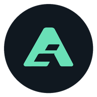
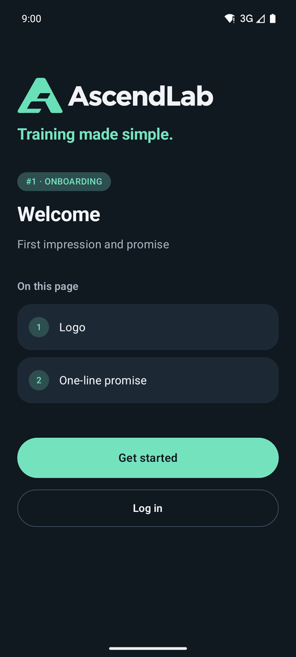
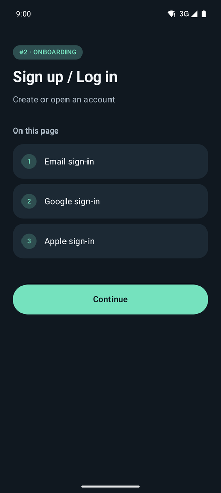
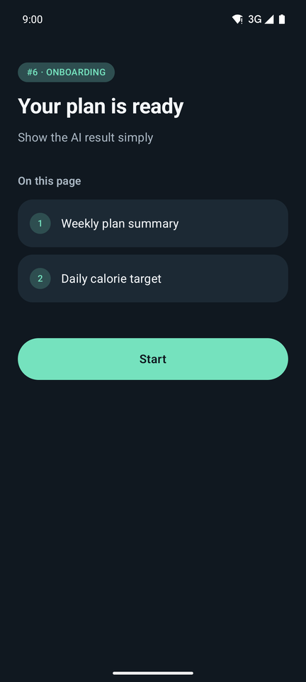
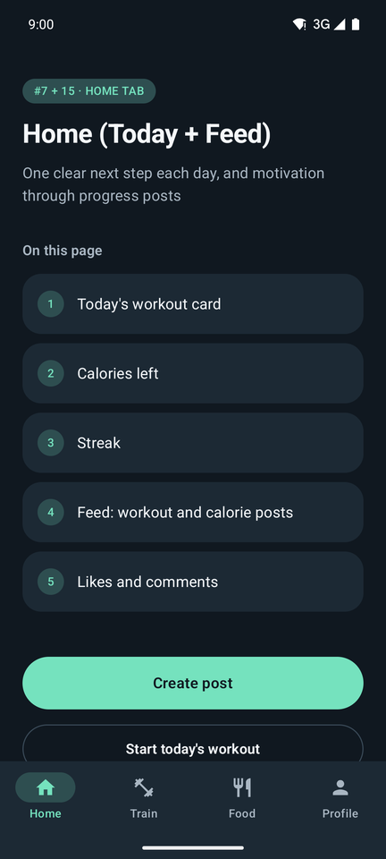
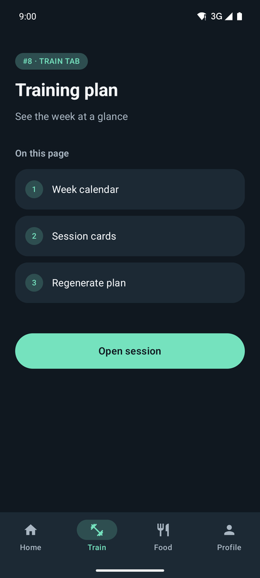
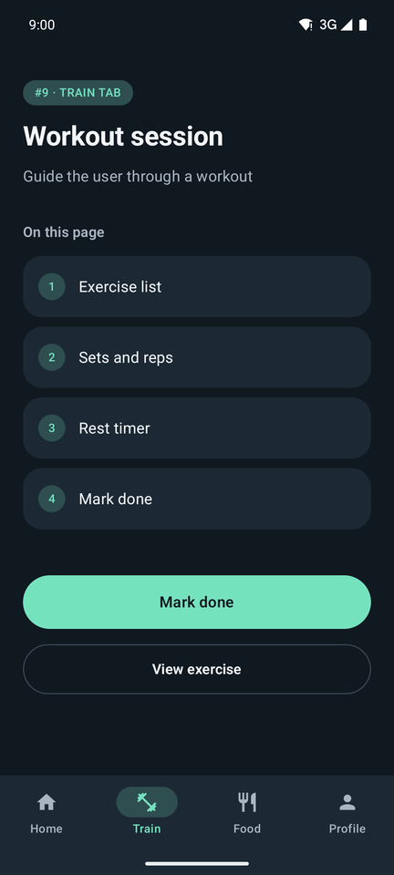
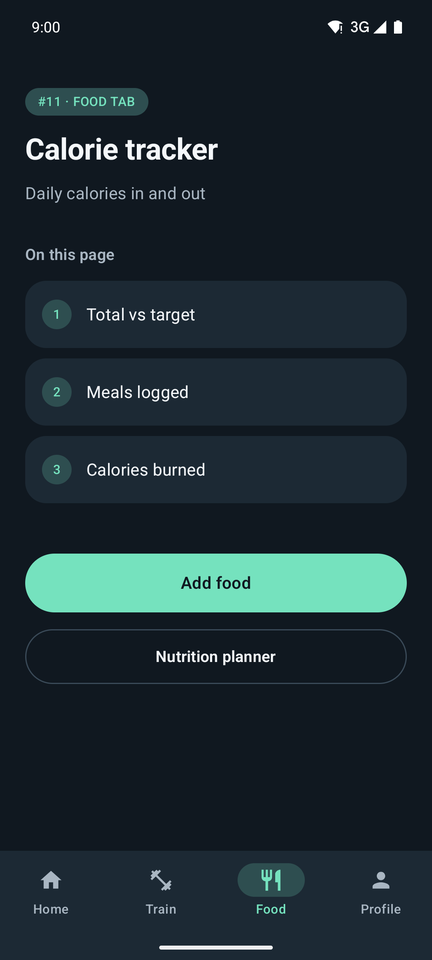
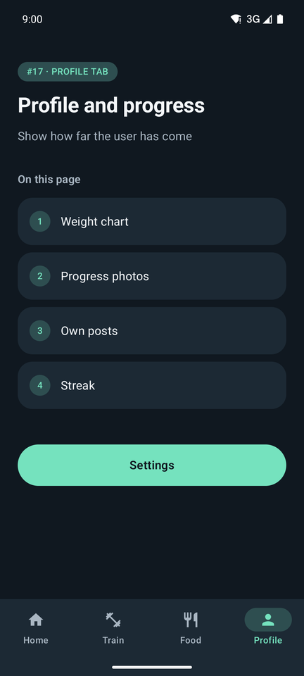

<p align="center">
  
</p>

<h1 align="center">AscendLab</h1>

<p align="center"><b>Training made simple.</b></p>

AscendLab is an Android fitness and nutrition app that helps everyone progress at their own pace: a training plan, a calorie tracker and a progress feed, without intimidating visuals or pressure to perform.

> **Status:** the app structure is in place. Every page is a styled placeholder that lists what it will hold and links to the pages it leads to; the features themselves are not built yet.

## Screenshots

| Welcome | Sign up | Plan ready | Home |
| :---: | :---: | :---: | :---: |
|  |  |  |  |
| **Training plan** | **Workout session** | **Calorie tracker** | **Profile** |
|  |  |  |  |

## Pages

| Section | Pages |
| --- | --- |
| Onboarding (shown once) | Welcome · Sign up / Log in · Choose your version · Your body · Your goals · Your plan is ready |
| Home tab | Home (Today + Feed) · Create post |
| Train tab | Training plan · Workout session · Exercise detail |
| Food tab | Calorie tracker · Add food · Nutrition planner · Meal detail |
| Profile tab | Profile and progress · Settings |

## Visual identity: "Daily Ascent"

Energy, clarity and steady progress. The logo is a geometric **A** whose cut-outs form ascending steps: progress, one step at a time.

| Role | Color | Code |
| --- | --- | --- |
| Main background | Midnight blue | `#101820` |
| Cards and surfaces | Slate blue | `#1C2934` |
| Primary accent and progress | Mint green | `#75E2BE` |
| Primary text | Soft white | `#F4F7FA` |
| Secondary text | Light gray | `#A9B6C2` |
| Occasional accent, milestones | Apricot | `#FFB987` |

- Dark-only theme, Roboto with bold headings and tabular numbers.
- Rounded cards, airy layout, one clearly visible primary action per screen.
- Progress is shown with a number and a label, never with color alone.

The theme lives in [`ui/theme/`](app/src/main/java/com/ascendlab/app/ui/theme).

## Tech stack

- Kotlin, Jetpack Compose, Material 3
- Navigation Compose with a bottom tab bar (Home, Train, Food, Profile)
- Min SDK 24, target SDK 35

## Build and run

Open the project in Android Studio and run the `app` configuration, or from the command line:

```bash
./gradlew :app:installDebug
```

## Project structure

```
app/src/main/java/com/ascendlab/app/
├── MainActivity.kt
└── ui/
    ├── components/   # Shared composables (placeholder page template)
    ├── navigation/   # Routes, tabs and the nav host
    ├── screens/      # One package per section: onboarding, home, train, food, profile
    └── theme/        # Colors, typography, shapes
```
