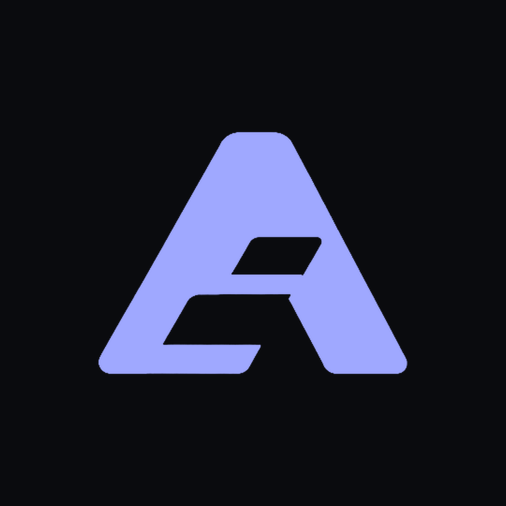
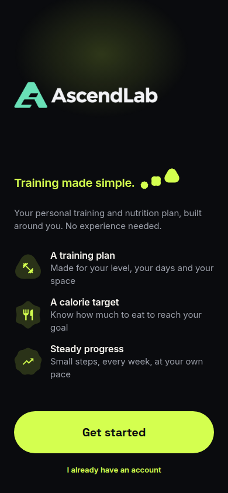
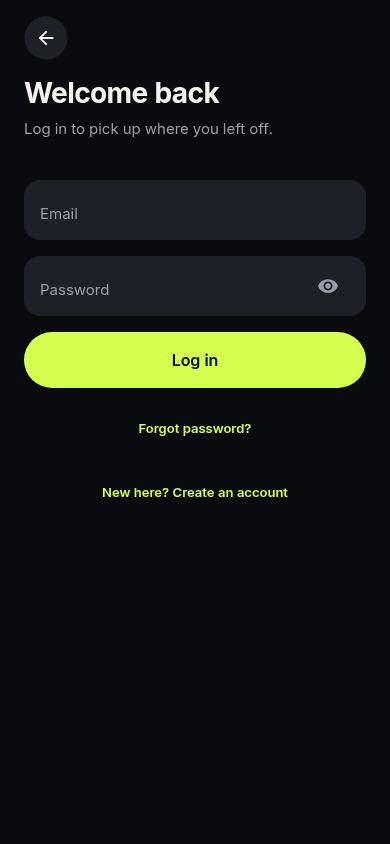
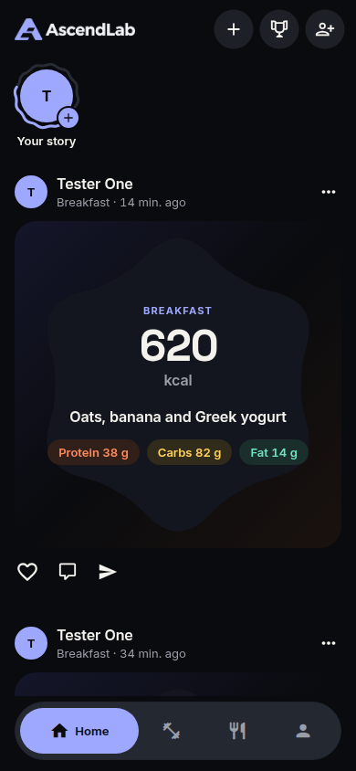
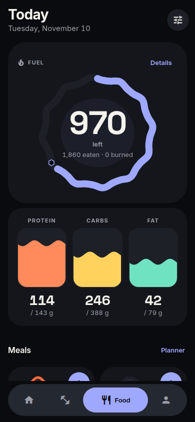
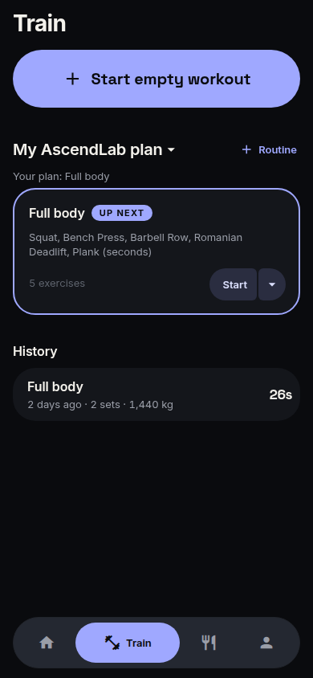
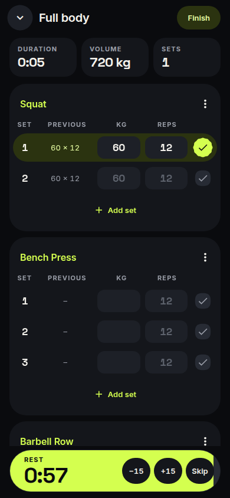
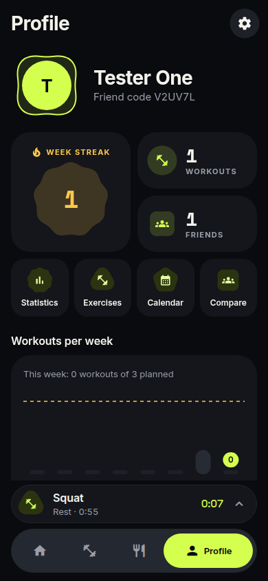
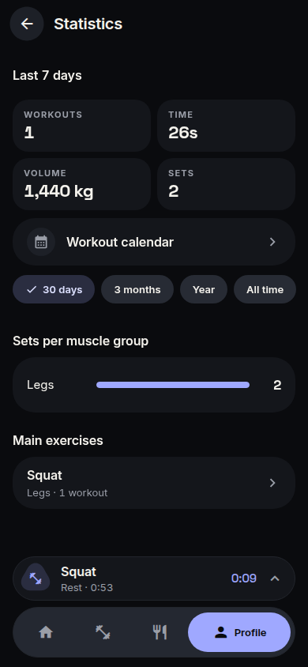

<p align="center">
  
</p>

<h1 align="center">AscendLab</h1>

<p align="center"><b>Training made simple.</b></p>

AscendLab is a fitness and nutrition app that helps everyone progress at their own pace: a training
plan built around you, a calorie and macro diary, and a feed to share meals and workouts with
friends. There are no intimidating visuals and no pressure to perform. It runs on iPhone, Android
and the web.

## Screenshots

| Welcome | Log in | Home | Food |
| :---: | :---: | :---: | :---: |
|  |  |  |  |
| **Train** | **Live workout** | **Profile** | **Statistics** |
|  |  |  |  |

## Features

- **Onboarding:** a few questions about your body, goal, level, training days and place. The app
  then builds your calorie and macro targets and a training split.
- **Train:** a generated program with routines and the routine that's up next. A live workout mode
  shows last time's sets, a rest timer, personal-record alerts, exercise swaps and alternatives.
  You also get history, statistics, a calendar and a library of 700+ exercises with photos and
  instructions.
- **Food:** a daily diary by meal (breakfast, lunch, dinner, snacks) with calories, protein, carbs
  and fat, an estimate of calories burned in workouts, and a nutrition planner.
- **Home:** meals and workouts from you and your friends, with likes, comments, stories and a
  daily "closest to goal" race.
- **Profile:** workouts per week, week streak, a body-weight trend, a comparison with friends, and
  settings.

## Design: "Ascent Expressive"

AscendLab is about climbing one small step at a time, so **progress is shape**. Every number
lives in a tile, and tiles carry shapes from one shared family (cookies, bursts, clovers,
pebbles, soft triangles) that **morph to show state**. For example, the Food tab's *Fuel Bloom*
is spiky when you have a lot left to eat, turns into a smooth circle when you reach your goal
("Summit reached"), and becomes an ember burst when you go over.

| Role | Token | Code |
| --- | --- | --- |
| Background | `ink` | `#0A0B0E` |
| Tiles and surfaces | `surface` / `surfaceHigh` | `#14161B` / `#1D2027` |
| Primary action and main progress | `primary` (iris) | `#9FA8FF` |
| Over budget, burned, destructive | `ember` | `#FF6B3D` |
| Milestones (PRs, streaks) | `gold` | `#FFC94A` |
| Protein · carbs · fat | `protein` · `carbs` · `fat` | `#FF8A5B` · `#FFD25E` · `#6FE3C1` |

- **Space Grotesk** for numbers and display text, **Inter** for UI text, tabular numbers everywhere.
- **Tiles for numbers, rows for lists.** Dashboards are bento grids of tiles; long lists sit
  on grouped surfaces.
- **One iris thing per screen is the hero.** Everything else uses tonal surfaces and the data colours.
- Spring motion and haptics, with reduce-motion respected, and progress always shown with a
  number and a label, never with colour or shape alone.

The full system is in [`docs/DESIGN_SYSTEM.md`](docs/DESIGN_SYSTEM.md). The tokens live in
[`mobile/src/ui/theme.ts`](mobile/src/ui/theme.ts) and the shapes in
[`mobile/src/ui/shapes/`](mobile/src/ui/shapes). Notes on the redesign are in
[`docs/REDESIGN_NOTES.md`](docs/REDESIGN_NOTES.md).

## Run it

The app lives in [`mobile/`](mobile) and is built with Expo and React Native.

```bash
cd mobile
npm install
cp .env.example .env.local   # then fill in the Firebase web config
npx expo start               # scan the QR code with Expo Go, or press w for the web
```

[`mobile/README.md`](mobile/README.md) covers the Firebase setup, Google sign-in (which needs a
development build) and the local Firebase emulators.

## Checks

```bash
cd mobile
npx tsc --noEmit
npx expo lint
npm test
```

## Tech stack

- Expo, React Native and TypeScript, running on iOS, Android and the web
- React Navigation (native stack and bottom tabs) with a custom floating tab dock
- Firebase Authentication and Cloud Firestore
- `react-native-svg` for the shapes and charts, and React Native `Animated` for the motion
- Inter and Space Grotesk through `@expo-google-fonts`

## Project structure

```
mobile/src/
├── data/        # Models and Firebase repositories
├── lib/         # Firebase setup, store, goal engine and program generator
├── state/       # Onboarding draft and session helpers
├── navigation/  # Pages, params, tab stacks
└── ui/
    ├── theme.ts     # Ascent Expressive tokens
    ├── motion.ts    # Springs and reduce-motion
    ├── shapes/      # The polar shape family, morphs, loaders
    ├── components/  # Core components, dock, Fuel Bloom, workout pieces, charts, feed
    └── screens/     # One folder per tab: onboarding, home, train, food, profile
```

`app/` holds the first version of AscendLab, a native Android app in Kotlin and Jetpack Compose.
The Expo app has replaced it and uses the same Firebase project.
