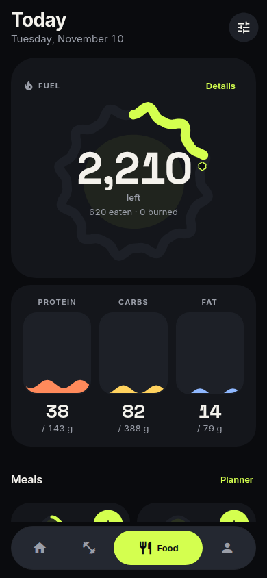
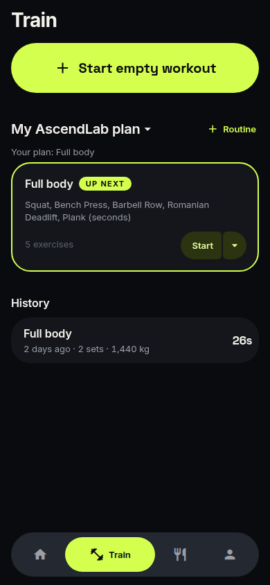
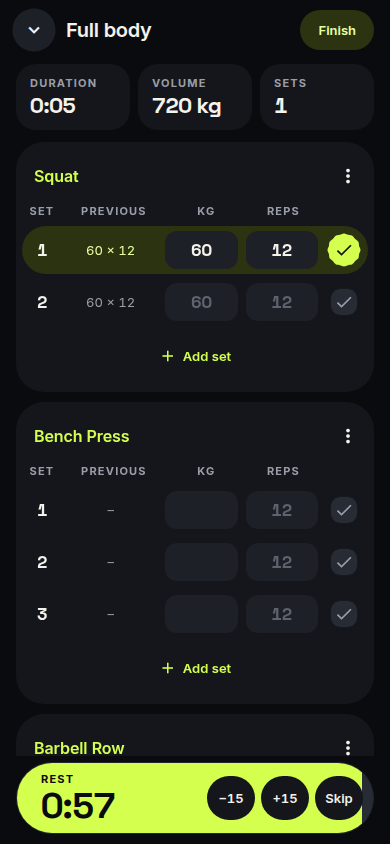
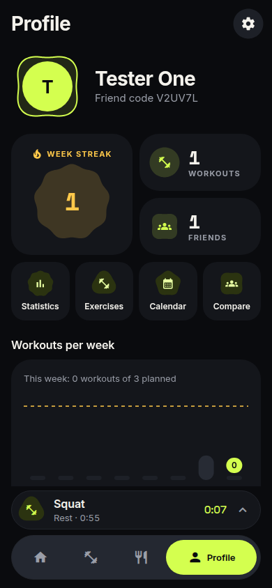

# Redesign notes: "Ascent Expressive"

Branch: `redesign/ascent-expressive`. Source of truth: `docs/DESIGN_SYSTEM.md`. This is a visual
redesign only: no data flow, navigation routes, Firebase calls or storage were changed.

## What changed

| Area | Files |
|---|---|
| Tokens: ink / lime / ember / gold palette, data and people palettes, `tone()`, radii, spacing, type scale, spring tokens, `ThemeProvider` + `useTheme()` | `mobile/src/ui/theme.ts` |
| Fonts: Inter + Space Grotesk loaded before the splash hides; `T` maps `fontWeight` to the right font file | `mobile/App.tsx`, `mobile/src/ui/components/core.tsx` |
| Splash, window and adaptive-icon background → ink | `mobile/app.config.ts`, `mobile/App.tsx` |
| Motion helpers: reduce-motion store, `springTo`, `fadeTo`, `useSpringNumber`, `useLoop` | `mobile/src/ui/motion.ts` |
| Shape system: polar shape family, named + meal shapes, `ExpressiveShape` (morph + progress along the outline), `WaveEdge`, `WavyProgress`, `ShapeLoader`, dev `ShapeGallery` | `mobile/src/ui/shapes/*` |
| Core components: morphing buttons, `HeroButton`, `SplitButton`, squishing `IconButton`, filled `TextField`, pill `Chip`, sliding `Segmented`, cookie `Toggle`, shimmer `Skeleton`, `HelpNote`, `Notice`, `EmptyState`, `Bento`/`Tile`/`TileHeader`/`TileNumber`, `ListGroup`/`ListRow` | `mobile/src/ui/components/core.tsx` |
| Overlays: dialog (shape icon, stacked buttons, scale-in), spring bottom sheet, action menu (sheet on phones, floating menu ≥ 600 px), toast with shape icon | `mobile/src/ui/components/overlays.tsx` |
| Floating tab dock with stretching lime indicator + workout mini player | `mobile/src/ui/components/dock.tsx`, `mobile/src/navigation/AppNavigator.tsx` |
| Signature components: Fuel Bloom, macro columns, meal tiles | `mobile/src/ui/components/fuel.tsx` |
| Ridge week, streak tile, story ring | `mobile/src/ui/components/progress.tsx` |
| Set check morph, shape set badges, rest timer pill + lime flash, PR badge + banner, stat tiles, ascent hero | `mobile/src/ui/components/workout.tsx` |
| Shape confetti | `mobile/src/ui/components/confetti.tsx` |
| Charts: pill bars + dashed goal, smooth area line with cookie marker + goal flag, thicker leader line | `mobile/src/ui/components/charts.tsx` |
| Feed: rounded posts inside the gutter, cover gradient + huge tonal shape, data-coloured macro pills, heart that splits into shapes, race podium, shared `MiniCover` | `mobile/src/ui/components/feed.tsx` |
| Plan blocks as tiles (Fuel Bloom preview, macro bars in data colours, ridge week) | `mobile/src/ui/components/plan.tsx` |
| Every screen | `mobile/src/ui/screens/**` |

Microcopy that changed, as the design system asks: "left" / "over" / "Summit reached" in the
Fuel Bloom, "You earned N more", "Rest · 1:30" (mini player, timer label), "New PR". The meal
rows became meal tiles: a tile opens a sheet with that meal's foods (remove buttons and "Add to …");
the tile's + still goes straight to logging.

## Shortcuts and decisions

- **No Reanimated.** Everything uses React Native `Animated` with the design system's spring
  tokens (damping / stiffness), plus `react-native-svg`. Reasons: the shape morphs regenerate an
  SVG path in JS each frame anyway, it avoids a new native module (and a dev-client rebuild for
  anyone not on Expo Go), and it kept the hour focused on the UI. Native-driver transforms are
  used wherever possible (dock indicator edges, flex weights, and SVG paths are JS-driven).
- **Tab dock in flow, not absolutely positioned.** The dock is rendered under the tab pages
  (floating visually with margins and a pill shape), so pages never need dock padding and
  nothing can hide behind it. Trade-off: content does not scroll *behind* the 92% dock.
- **Theme provider, static tokens.** `ThemeProvider` / `useTheme()` exist, but screens import the
  static `palette` etc. (the dark theme's values). A light theme needs screens to read
  `useTheme()`; the old aliases (`c`, `colors`) were removed by migrating every usage directly.
- **Tabs in Exercise detail** use the sliding `Segmented` control instead of an underline tab bar.
- **Font weights**: `T` resolves `fontWeight` overrides to font files; raw `TextInput`s use the
  `type.*` styles directly.
- **Icons** are still the standard Material set (default size 22). `@expo/vector-icons` has no
  "Rounded" Material family; switching would need Material Symbols.

## Follow-up fixes

- **No pressable inside a pressable.** `Tile` has an `overlay` slot: buttons that belong on a
  tappable tile (Resume on the active workout, Start ▾ on routines) are drawn over it as an
  absolutely positioned sibling, with a spacer keeping the layout identical. The meal tile + and
  the story-bubble + are siblings of their tile/bubble. A `ListRow` with both `onPress` and a
  `trailing` control renders the control beside the pressable instead of inside it. The web
  build no longer logs the `<button>` inside `<button>` warning.
- **Faster shapes.** Shapes are sampled at 96 points (was 144). Geometry for the named shapes
  (and the set-check squircle) is cached by spec + size + inset via `markStatic()` and
  `shapeGeometry()` in `shapes/polar.ts`; mid-morph specs are never cached. A large render
  (240 px, 14 px stroke, emberBurst included) and mid-morph frames stay smooth.

## Screenshots (web, emulator test account)

| Food | Train | Live workout | Profile |
| :---: | :---: | :---: | :---: |
|  |  |  |  |

## Checked

- `npx tsc --noEmit` and `npx expo lint` pass with no errors or warnings in `mobile/src/ui`.
- The web build was run against the local Firebase emulators with the e2e test account: Welcome,
  Home, Food (incl. the meal sheet and logging a meal), Train (incl. mini player), live workout
  (set ticked, rest pill) and Profile render without console errors or warnings. Shapes were also rendered to an image to
  check that they are smooth, morphs included.

## Left to do

- **Real devices**: haptics, Inter / Space Grotesk on iOS vs Android, and the cost of JS-driven
  SVG morphs (Fuel Bloom, many `IconButton` squishes in long lists) on low-end Android.
- **TabHeader collapse on scroll** (small centred title over a 90% ink bar) is not built.
- **Shared-element "tile scales into the page"** transition and spring timing for native-stack
  transitions are not built (native-stack animations are platform-driven).
- **Logo and app icon** are still the mint "Daily Ascent" artwork (`assets/`); they need new
  lime-on-ink exports.
- **Light theme**: move screens from static `palette` to `useTheme()`.
- **Onboarding sub-pages** (Sign up, Choose version, Your body, Your goals, Edit goals) are
  restyled through the shared scaffold and components only; no page-specific polish.
- **Story viewer** keeps its black photo layout (now on theme tokens).
- **Streak tile**: the lobe-gain animation is wired to an increase of the streak while the screen is
  open; it doesn't replay "since last visit".
